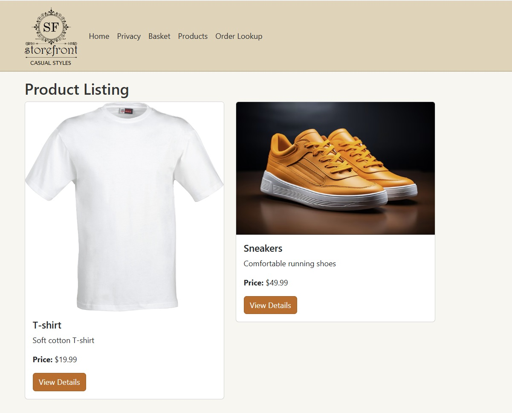
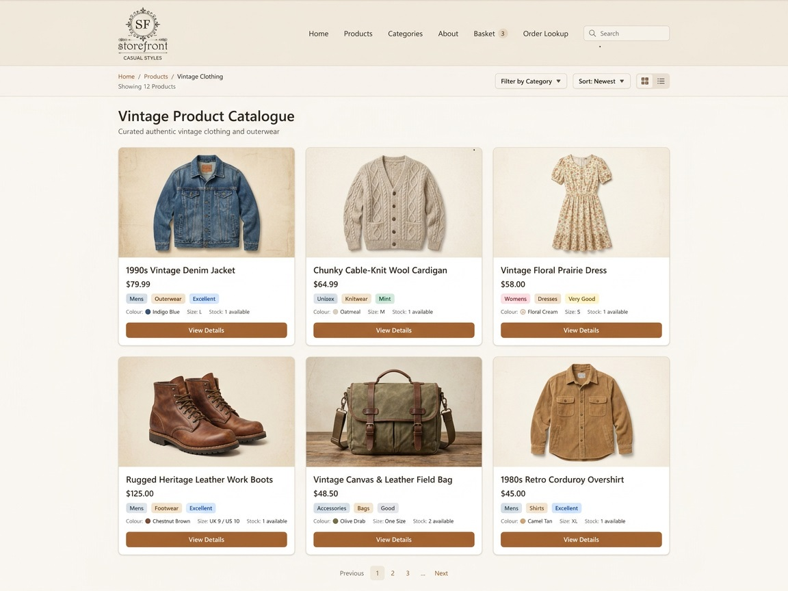
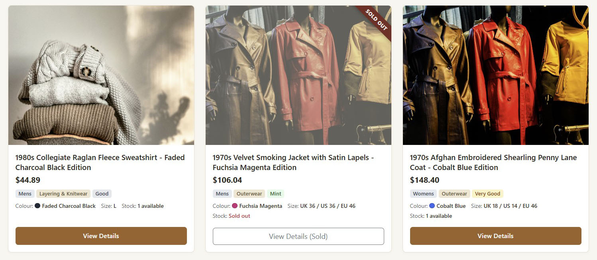

In the previous two articles, we focused on creating a richer and more realistic product catalogue for our ASP.NET Core storefront. First, we used AI to generate realistic sample product data and then moved that catalogue into an external JSON file to create a more maintainable data seeding process.

With those foundations in place, attention could finally turn to the customer-facing experience. The storefront now contained significantly more information about each product, but the user interface had not evolved to take advantage of it. This article explores how I redesigned the product listing experience using reusable product cards that expose the catalogue's richer metadata while remaining clean, responsive and easy to browse.

The code for this article is available in the GitHub repository linked from the site header.

---

## 1 The Problem

The original storefront product listing detailed in my book *Building your First Shopping Basket* was intentionally simple. A product image, title and price were enough while the catalogue contained only basic product data.

Following the previous articles in this series, [Using AI to Generate Realistic Sample Data for an ASP.NET Core Storefront](/blog/using-ai-to-generate-realistic-sample-data-for-an-aspnet-core-storefront) and [Building a Data Seeding System in ASP.NET Core](/blog/building-a-data-seeding-system-in-aspnet-core), the product model had evolved considerably. Products now included audience information, condition ratings, inventory status, colour metadata and sizing information.

It quickly became obvious that the existing listing page could no longer communicate the richness of the underlying catalogue.



---

## 2 Establishing the Product Card Design

Before writing any Razor markup, I wanted to establish what the upgraded catalogue experience should look like.

Rather than opening Figma, I asked Gemini to generate a realistic catalogue page based on the evolved product model and the existing storefront styling. The prompt focused on a few key requirements:

- A responsive three-column product grid
- Reusable product cards
- Prominent audience, category and condition badges
- Colour indicators and sizing information
- Stock availability
- Consistent image aspect ratios
- Bootstrap inspired implementation
- Existing storefront colours and branding
- A design suitable for product listings, category pages and search results

I also specified a visual hierarchy:

1. Product image
2. Product name
3. Price
4. Metadata badges
5. Secondary metadata
6. Call-to-action button

Most importantly, I asked for a design that felt realistic and implementable rather than a conceptual UI mockup.



The generated design was surprisingly close to what I had in mind.

More importantly, it exposed a useful architectural question. Looking at the card, what data should a reusable ProductCard component actually require? Rather than jumping straight into implementation, I supplied both the mockup and my new Product model to Gemini and asked it to define the component contract.

---

## 3 Defining the Product Card Contract

With a proposed card design in place, the next question wasn't how to implement the component, but what data it should consume.

I supplied Gemini with both the new `Product` model and the catalogue mockup, then asked a simple question:

> Given this Product model and the proposed card design, what should the ProductCard component accept as input?

### 3.1 Introducing the ProductCardViewModel

Rather than suggesting that the component render a `Product` entity directly, Gemini recommended introducing a dedicated `ProductCardViewModel`.

The reasoning was sound. A dedicated view model would keep presentation concerns out of the domain model, avoid unnecessary coupling to Entity Framework navigation properties, and allow page models to project directly into the shape required by the UI.

Gemini's opening recommendation was:

> For a Razor Pages application, your ProductCard partial view (`_ProductCard.cshtml`) or ViewComponent should accept a dedicated `ProductCardViewModel` rather than the raw `Product` entity directly.
>
> Passing a flat ViewModel prevents `NullReferenceException` issues if `Category` wasn't `.Include()`d in an EF Core query, keeps UI presentation logic (such as badge styling and colour swatches) out of Razor markup, and avoids over-fetching fields that the card never uses.

```csharp
namespace Storefront.ViewModels;

public class ProductCardViewModel
{
    // Routing & Identity
    public int Id { get; set; }
    public string Slug { get; set; } = string.Empty;

    // Core Display
    public string Name { get; set; } = string.Empty;
    public string ImageUrl { get; set; } = string.Empty;
    public decimal Price { get; set; }

    // Badges
    public string AudienceLabel { get; set; } = string.Empty;      // e.g. "Mens"
    public string CategoryName { get; set; } = string.Empty;       // e.g. "Footwear"
    public string ConditionLabel { get; set; } = string.Empty;     // e.g. "Excellent"
    public string ConditionBadgeCss { get; set; } = string.Empty;  // e.g. "badge-condition-excellent"

    // Secondary Metadata Row
    public string ColourName { get; set; } = string.Empty;         // e.g. "Chestnut Brown"
    public string ColourHex { get; set; } = "#808080";             // Mapped from BaseColour for the swatch dot
    public string? Size { get; set; }                              // e.g. "UK 9 / US 10" (hidden when null)
    public int StockQuantity { get; set; }                         // Drives "1 available" vs "Sold Out"
}
```

Introducing a dedicated `ProductCardViewModel` brought a number of advantages.

The view model is shaped specifically around the needs of the card component rather than the underlying domain entity. This means the card only receives the data it actually needs to render, keeping the component focused on presentation concerns.

It also avoids coupling the UI directly to the `Product` entity and its navigation properties. Instead of passing an entire domain object into the view, catalogue pages can project directly into the shape required by the component.

Most importantly, the resulting card became genuinely reusable. The same view model could be used to render product listings, category pages, search results, featured products and any future catalogue experiences without exposing additional product data that the UI doesn't need.

### 3.2 Projecting Directly into the Card Model

An additional benefit of introducing a dedicated `ProductCardViewModel` was that pages no longer needed to load full `Product` entities and then transform them inside the view.

Instead, Entity Framework could project directly into the shape required by the card component:

```csharp
var products = await _context.Products
    .AsNoTracking()
    .Select(p => new ProductCardViewModel
    {
        Id = p.Id,
        Slug = p.Slug,
        Name = p.Name,
        ImageUrl = p.ImageUrl,
        Price = p.Price,
        AudienceLabel = p.Audience.ToString(),
        CategoryName = p.Category.Name,
        ConditionLabel = p.Condition.ToString(),
        ConditionBadgeCss = p.Condition.ToBadgeCssClass(),
        ColourName = p.Colour,
        ColourHex = p.BaseColour.ToHexCode(),
        Size = p.Size,
        StockQuantity = p.StockQuantity
    })
    .ToListAsync();
```
This has several advantages. Only the data required by the UI is retrieved, presentation specific values can be prepared before rendering and the card component remains completely independent of Entity Framework navigation properties.

Most importantly, the card can now be reused anywhere in the application. Product listings, category pages, search results and featured product sections can all consume the same ProductCardViewModel and render the same component consistently.

---

## 4 Building the Product Card

With the `ProductCardViewModel` defined, the card itself became surprisingly straightforward to implement. Most of the complexity had already been pushed into the view model, leaving the Razor partial responsible only for presentation.

The card follows the visual hierarchy established in the mockup:

* Product image
* Product name
* Price
* Metadata badges
* Secondary metadata
* Call-to-action button

The complete implementation can be found in the repository, but a few sections are worth highlighting.

### 4.1 Sold-Out Products

The first thing the partial does is determine whether the item is still available.

```csharp
@{
    var isSoldOut = Model.StockQuantity <= 0;
}
```

This simple flag allows the component to alter its appearance, display a ribbon overlay and adjust the call-to-action button without duplicating logic throughout the view.

### 4.2 Product Image

The image remains the most visually important element in the card.

```HTML
<a asp-page="/ProductDetail"
   asp-route-slug="@Model.Slug"
   aria-label="View @Model.Name">

    
</a>
```

Using the product slug in the route keeps URLs clean and user-friendly, while lazy loading helps improve page performance when displaying larger catalogues.

### 4.3 Metadata Badges

One of the goals of the redesign was to expose more catalogue information without overwhelming the user.

```csharp
<div class="d-flex flex-wrap gap-1 mb-2">
    <span class="badge storefront-badge badge-audience">
        @Model.AudienceLabel
    </span>

    <span class="badge storefront-badge badge-category">
        @Model.CategoryName
    </span>

    <span class="badge storefront-badge @Model.ConditionBadgeCss">
        @Model.ConditionLabel
    </span>
</div>
```

By projecting presentation ready values into the view model, the partial remains free from switch statements and enum mapping logic.

### 4.4 Colour, Size and Stock Information

The secondary metadata section surfaces product details that would otherwise require customers to visit the product detail page.

```csharp
<span class="text-muted">Colour:</span>
<span class="colour-swatch"
      style="background-color: @Model.ColourHex;">
</span>
<span>@Model.ColourName</span>
```

Size information is displayed only when available, while stock quantity is used to communicate product availability and support the vintage store's one-of-a-kind inventory model.

### 4.5 View Details

Finally, each card includes a single call-to-action.

```HTML
<a asp-page="/ProductDetail"
   asp-route-slug="@Model.Slug"
   class="btn btn-bronze w-100">
    View Details
</a>
```

A reusable component like this can now be used throughout the application:

* Product listings
* Category pages
* Search results
* Featured product sections

without duplicating markup or styling.

---

## 5 Styling the Card

Whilst the Razor partial is responsible for structuring the content, much of the work involved in creating a professional-looking catalogue experience comes from the accompanying CSS.

Several styling decisions were particularly important in achieving a consistent card layout.

### 5.1 Maintaining Equal Height Cards

One common challenge with product listings is that product names and metadata vary in length. Without some form of layout control, cards quickly become uneven, causing buttons and content to appear misaligned.

Bootstrap's flex utilities make this easy to solve:

```HTML
<article class="card storefront-card h-100">
```

combined with:

```HTML
<div class="card-body d-flex flex-column">
```

and:

```HTML
<div class="mt-auto">
    <a class="btn btn-bronze w-100">
        View Details
    </a>
</div>
```

Using `h-100` ensures all cards fill the height of their container, whilst `mt-auto` pushes the call-to-action button to the bottom of the card. The result is a cleaner and more professional grid layout.

### 5.2 Consistent Product Images

Product photography rarely arrives in perfectly consistent dimensions. Without additional styling, some cards would display portrait images whilst others display landscape images, creating visual clutter.

To avoid this, each image is displayed within a fixed aspect ratio container:

```CSS
.storefront-card-img-wrap {
    aspect-ratio: 4 / 3;
    overflow: hidden;
}
```

The image itself then uses:

```CSS
.storefront-card-img {
    width: 100%;
    height: 100%;
    object-fit: cover;
}
```

The combination of `aspect-ratio` and `object-fit: cover` ensures every card presents a consistent image area regardless of the dimensions of the original photograph.

### 5.3 Colour Coded Condition Badges

The redesigned catalogue surfaces condition information directly within the card using colour coded badges:

| Condition Rating | Badge Colour |
|------------------|--------------|
| Mint | Green |
| Excellent | Blue |
| Very Good | Amber |
| Good | Grey |

This allows customers to assess the quality of an item at a glance without needing to open the product detail page.

The badge styling is driven by CSS classes generated by the `ProductCardViewModel`, keeping presentation concerns out of the Razor view.

```CSS
.badge-condition-excellent {
    background-color: #dbeafe;
    color: #1e40af;
}
```

### 5.4 Colour Swatches

The enriched product model introduced both a descriptive colour name and a standardised base colour value.

This makes it possible to display a visual swatch alongside the human-readable colour description:

```HTML
<span class="colour-swatch"
      style="background-color: @Model.ColourHex;">
</span>
```

This is a small feature, but one that significantly improves the browsing experience, particularly for clothing and accessories.

### 5.5 Responsive Bootstrap Layout

Finally, the catalogue page itself uses Bootstrap's responsive grid system:

```HTML
<div class="row row-cols-1 row-cols-md-2 row-cols-lg-3 g-4">
```

This automatically adapts the layout for different screen sizes:

* One column on small screens
* Two columns on medium screens
* Three columns on larger displays

Because the card component is entirely self-contained, the same partial can be reused throughout the storefront, whether displaying featured products on the homepage, search results, category listings or future filtered views.

---

## 6 Integrating the Product Card

### 6.1 Rendering the Product Grid

Up to this point we've focused on the card itself. The final step is integrating the component into the catalogue page.

Because the card is implemented as a reusable partial view and consumes a dedicated `ProductCardViewModel`, rendering a catalogue becomes very simple.

```csharp
<div class="row row-cols-1 row-cols-md-2 row-cols-lg-3 g-4">
    @foreach (var product in Model.Products)
    {
        <div class="col">
            <partial name="_ProductCard" model="product" />
        </div>
    }
</div>
```

Bootstrap's responsive grid handles the layout:

* One card per row on smaller devices
* Two cards per row on medium sized screens
* Three cards per row on larger displays

Because all product specific presentation logic has already been encapsulated within the card component, the catalogue page itself becomes little more than a loop over a collection of products.

### 6.2 Updating the Page Model

The final change was updating the product listing page to return a collection of 'ProductCardViewModel' instances rather than the underlying `Product` entities.

This allows the page to project directly from Entity Framework Core into the exact shape required by the UI:

```csharp
var products = await _context.Products
    .AsNoTracking()
    .Select(p => new ProductCardViewModel
    {
        Id = p.Id,
        Slug = p.Slug,
        Name = p.Name,
        ImageUrl = p.ImageUrl,
        Price = p.Price,
        AudienceLabel = p.Audience.ToString(),
        CategoryName = p.Category.Name,
        ConditionLabel = p.Condition.ToDisplayLabel(),
        ConditionBadgeCss = p.Condition.ToBadgeCssClass(),
        ColourName = p.Colour,
        ColourHex = p.BaseColour.ToHexCode(),
        Size = p.Size,
        StockQuantity = p.StockQuantity
    })
    .ToListAsync();
```

By projecting directly into a presentation model, the page avoids loading unnecessary fields such as product descriptions whilst also keeping view-specific concerns out of the domain model.

---

## 7 The Finished Catalogue

With the card component integrated into the product listing page, the storefront is able to surface significantly richer product metadata whilst maintaining a clean and consistent browsing experience.

Customers can now see audience, category, condition, colour, sizing and stock information directly from the catalogue view. The use of consistent image ratios, equal height cards and colour coded badges helps communicate this additional information without overwhelming the interface.

The result is a browsing experience that feels considerably closer to a real ecommerce catalogue than the simple product listing introduced earlier in the series.



---

What began as a simple product listing evolved into a reusable card based catalogue architecture capable of surfacing significantly richer product information.

Starting with a design mockup helped define the target user experience, whilst introducing a dedicated `ProductCardViewModel` created a clean contract between the domain model and the UI. The resulting component can now be reused across product listings, category pages, featured product sections and future search results.

More importantly, the storefront is now in a position to support a much larger catalogue. As the number of products grows, however, a new problem emerges: helping customers find what they're looking for.

In the next article, we'll introduce search, filtering and pagination, allowing customers to navigate an increasingly realistic product catalogue with ease.